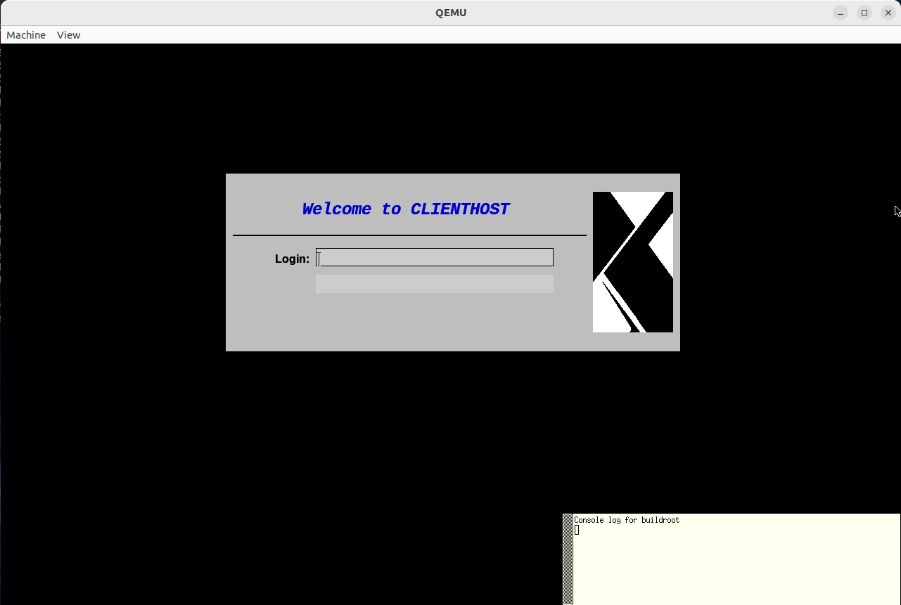
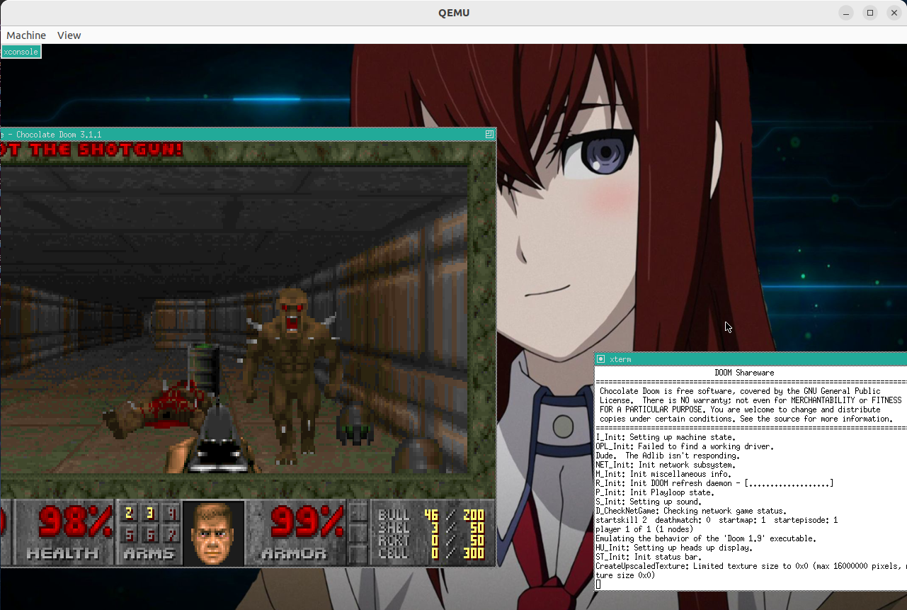

# Races and Barriers

## Initialization

* An "auto-load safe-path" should be set in ~/.gdbinit, either / or a path to this directory:

```shell
echo "set auto-load safe-path /" >> ~/.gdbinit
```

* Install libraries required for Qemu and Buildroot:

```shell
# Fedora
sudo dnf install \
  ncurses-devel perl-ExtUtils-MakeMaker ninja-build \
  glib2-devel pixman-devel libslirp-devel \
  perl-IPC-Cmd perl-open lz4 gawk make gcc \
  libmpc-devel gmp-devel

# Ubuntu
sudo apt install \
  libncurses-dev libextutils-makemaker-cpanfile-perl ninja-build \
  libglib2.0-dev libpixman-1-dev libslirp-dev
  libipc-run-perl lz4 gawk make gcc \
  libmpc-dev libgmp-dev
```

* Build everything:

```shell
./init_build.sh
```

---

## Running Optimization Demo

* Start Qemu

```shell
./7_run.sh
```

* Enter login `root` (password root)
* Read and edit the code


* Rebuild and re-run

```shell
./rebuild_rerun.sh
```

* Exit Qemu with key combination `Ctrl + A, X` or `poweroff`




